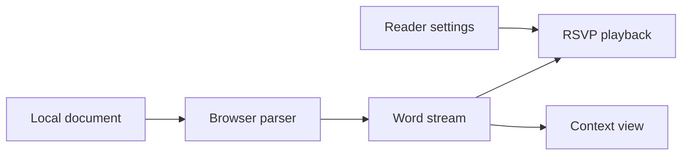

# Rasvip | Browser-based RSVP Reader

**A static web application for customizable rapid serial visual presentation (RSVP).**

Load local text, PDF, EPUB or DOCX documents and read at an adjustable pace. Reading files are processed in the browser; external library assets may be loaded from CDNs.

  
  

## Quickstart

Open `index.html` or serve the repository locally with `python -m http.server 8000`, then visit `http://localhost:8000`. An internet connection may be required for CDN libraries.

## Architecture

RSVP and bionic formatting are optional presentation modes; improved comprehension or clinical benefits are not established by this project.

## Features

*   **Adjustable Speed:** Control your reading pace from a leisurely 50 WPM to a lightning-fast 1200 WPM with a smooth slider.
*   **Multiple Themes:** Choose from Dark, Light, Sepia, Neon, Ocean, and more to find the perfect reading environment for your eyes.
*   **Font Customization:** Select from a range of sans-serif, serif, and monospace fonts to suit your preference.
*   **Text Size Control:** Easily adjust the size of the displayed word for optimal comfort.
*   **Bionic Text Toggle:** Switch Bionic Reading on or off with a single click.
*   **Full Document Viewer:** A collapsible panel displays the full text of your document, with the current word automatically highlighted and scrolled into view.
*   **Interactive Text:** Click on any word in the document viewer to instantly jump to that position in the RSVP reader.
*   **Fullscreen Mode:** Immerse yourself completely with a distraction-free fullscreen reading experience.
*   **Responsive Design:** Enjoy a seamless experience on any device, from desktops to tablets and mobile phones.
*   **Keyboard Shortcuts:** Control playback, navigation, and UI panels with intuitive keyboard shortcuts.

## Controls & Shortcuts

Master the reader with these simple on-screen controls and keyboard shortcuts.

### On-Screen Controls

*   **Top Bar:**
    *   **Gear Icon:** Toggles the settings panel (WPM, font, themes, etc.).
    *   **WPM Slider:** Adjusts the reading speed in Words Per Minute.
    *   **File Icon:** Toggles the full document viewer panel.
*   **Bottom Bar:**
    *   **Restart Button:** Jumps back to the beginning of the text.
    *   **Previous Word Button:** Moves one word backward.
    *   **Play/Pause Button:** Starts or stops the RSVP reading.
    *   **Next Word Button:** Moves one word forward.
    *   **Fullscreen Button:** Enters or exits the immersive fullscreen mode.

### Keyboard Shortcuts

| Key(s) | Action |
| :--- | :--- |
| `Spacebar` | Play / Pause Reading |
| `ArrowLeft` | Previous Word |
| `ArrowRight`| Next Word |
| `Home` | Restart from Beginning |
| `F` or `f` | Toggle Fullscreen Mode |
| `S` or `s` | Toggle Settings Panel |
| `D` or `d` | Toggle Document View Panel |
| `Escape` | Exit Fullscreen Mode |

---

## Technology Stack

This project is intentionally built with simplicity and portability in mind. It's a "zero-dependency" application in the sense that you don't need `npm`, build steps, or a server to run it.

*   **HTML5, CSS3, and Vanilla JavaScript (ES6+):** The core of the application is built with modern, framework-free web standards for maximum performance and compatibility.
*   **CSS Custom Properties (Variables):** Used extensively for powerful theming and easy customization of the UI.

### External Libraries

To handle complex file parsing, the application loads the following battle-tested, open-source libraries from a CDN:

*   **[PDF.js](https://mozilla.github.io/pdf.js/) (by Mozilla):** Used to parse and extract text content from PDF files directly in the browser.
*   **[ePub.js](https://github.com/futurepress/epub.js/)**: A comprehensive library for rendering and parsing `.epub` files, with a dependency on **JSZip** for unzipping the book content.
*   **[Mammoth.js](https://github.com/mwilliamson/mammoth.js)**: A lightweight library for converting `.docx` (Microsoft Word) files into clean HTML and extracting raw text.
*   **[Bootstrap Icons](https://icons.getbootstrap.com/)**: Provides the clean and modern icon set used throughout the user interface.

## Contributing

We welcome contributions of all kinds! Whether it's reporting a bug, suggesting a new feature, or submitting a pull request, your input is valued. Please feel free to open an issue to start a discussion.

---

## References

 **Rapid Serial Visual Presentation** - Wikipedia. [https://en.wikipedia.org/wiki/Rapid_serial_visual_presentation](https://en.wikipedia.org/wiki/Rapid_serial_visual_presentation)

 **Bionic Reading®** - The official Bionic Reading website. [https://bionic-reading.com/](https://bionic-reading.com/)
